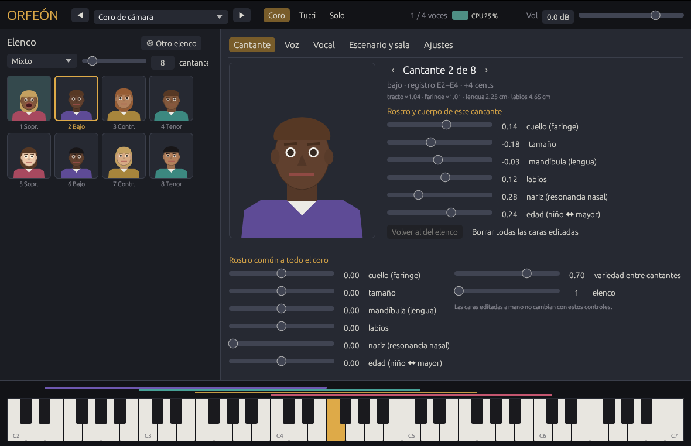

# Orfeón

Coro de cantantes modelados físicamente. Sin samples y sin modelos neuronales: cada cantante
es una simulación propia de pulmones, cuerdas vocales, garganta, boca y nariz, con su cuerpo,
su rostro y su manera de cantar.



Libre (GPL-3.0-or-later). El motor de voz es [CHIMERA](https://github.com/jamesondh/chimera-vocal-synth)
de Jameson Hodge (MIT), usado como dependencia sin modificar. Ver [`NOTICE.md`](NOTICE.md).

Se usa como **app independiente** (Windows, macOS, Linux) o como **plugin VST3 / CLAP**, con
la misma ventana en los dos.

## Estado (0.2.0)

| Parte | Estado |
|---|---|
| Núcleo (`crates/orfeon-core`) | 16 tests pasan. |
| Interfaz (`crates/orfeon-ui`) | La misma en la app y en el plugin. Probada abriendo la app en Linux y la versión de Windows bajo Wine. |
| App (`crates/orfeon-app`) | Linux y Windows compilados y probados (Windows bajo Wine, con una salida de audio virtual). macOS: se compila en GitHub Actions; no se probó en una Mac. |
| Plugin VST3 / CLAP (`crates/orfeon-plugin`) | Compila para Linux y Windows y pasa el chequeo de compilación para macOS. **Nunca se cargó en un DAW.** |
| Render por línea de comandos (`crates/orfeon-cli`) | Funciona; el `.exe` bajo Wine da el mismo audio byte a byte que en Linux. |
| Sonido | Ajustado por medición; falta escucharlo y afinarlo a oído. |

## La ventana

- **Barra de arriba**: 36 programas (flechas y lista), modo **Coro** (una voz por nota),
  **Tutti** (todos la misma nota, cada uno en su octava) o **Solo** (un cantante, ligado),
  voces sonando, carga de CPU, volumen.
- **Elenco** (izquierda): una cara por cantante, dibujada a partir de su rostro y su cuerpo. Se
  ilumina y abre la boca, con la forma de la vocal, cuando canta. Conjunto, cantidad (1 a 64),
  "otro elenco". Click en una cara para editarla.
- **Cantante**: retrato grande y seis controles de **ese** cantante: cuello (faringe), tamaño,
  mandíbula (lengua), labios, nariz (resonancia nasal) y edad. Abajo, el rostro común de todo el
  coro y cuánto varía cada uno.
- **Voz**: ocho estilos (Clásico, Antiguo, Pop, Gospel, Folk, Susurro, Belting, Rasgado),
  vibrato, aire, brillo y humanizar.
- **Vocal**: carta de vocales (la de CHIMERA) con un punto para arrastrar, botones A E I O U y
  movimiento automático.
- **Escenario y sala**: cada cantante en su lugar (cuerdas de izquierda a derecha, graves
  atrás; click para elegirlo), la sala de fondo y el micrófono. Cinco salas, cantidad de sala,
  distancia del micrófono, ancho y fondo.
- **Ajustes**: calidad Alta o Eco, tope de voces a la vez, hilos. En la app, además, colchón de
  audio, cortes y teclado MIDI.
- **Teclado** de C2 a C7, con el registro de cada tipo de voz marcado arriba. Se toca con el
  mouse, con un teclado MIDI o desde el DAW.

En el plugin cada control es un parámetro del DAW (automatizable). Las caras editadas a mano y
el programa elegido se guardan con el proyecto. Editar la cara de un cantante reconstruye sólo
a ese cantante: los demás siguen sonando.

## Probarlo

### Paquetes

`.github/workflows/compilar.yml` compila en GitHub Actions, en cada subida:

- **macOS** (universal, Intel y Apple Silicon): `Orfeon.app`, plugin VST3 y CLAP, renderizador.
  Firma ad hoc, sin notarizar: la primera vez se abre con click derecho → Abrir.
- **Windows**: `Orfeon.exe`, plugin, renderizador y un lanzador de modo seguro.
- **Linux**: app, plugin y renderizador.

Quedan en la pestaña *Actions* de cada corrida ("Artifacts"). Al subir una etiqueta `v*`
(por ejemplo `git tag v0.2.0 && git push --tags`) además se publica una versión en *Releases*.
macOS sólo se puede compilar en una Mac (hace falta el SDK de Apple), por eso va por Actions.

Las guías de cada paquete están en `docs/LEEME-windows.txt` y `docs/LEEME-mac.txt`.

### Desde el código

Hace falta [Rust](https://rustup.rs). En Linux, además, las bibliotecas de audio, X11 y
OpenGL (la lista está en el workflow).

```sh
cargo test --release                                  # tests
cargo run --release -p orfeon-app                     # la app con ventana
cargo run --release -p orfeon-app -- --consola        # la app por comandos de texto
cargo xtask bundle orfeon-plugin --release            # plugin: target/bundled/Orfeon.{clap,vst3}
cargo run --release -p orfeon-cli -- render coro.wav --preset 1
cargo run --release -p orfeon-cli -- bench            # cuántas voces aguanta la máquina
```

Si la ventana no abre (máquinas virtuales, escritorio remoto, OpenGL viejo): variable de
entorno `ORFEON_GL_SIMPLE=1` (en Windows, el lanzador "modo seguro").

Para rendir música propia sin DAW, un archivo de texto con una nota por línea
(`inicio duración nota [velocidad]`, en segundos y número MIDI) y
`orfeon-cli render salida.wav --score notas.txt --preset 7`.

### Compilar para Windows desde Linux

Con `mingw-w64` y `rustup target add x86_64-pc-windows-gnu`:

```sh
cargo build --release --target x86_64-pc-windows-gnu -p orfeon-app -p orfeon-cli
cargo xtask bundle orfeon-plugin --release --target x86_64-pc-windows-gnu
```

Salen enlazados estáticamente: no necesitan DLL aparte.

## Cuánto cuesta

Cada cantante que suena es una simulación completa. Medido en una máquina virtual de 4
núcleos; 100 % = tiempo real:

| Voces a la vez | Alta, 4 hilos | Eco, 4 hilos | Alta, 1 hilo |
|---|---|---|---|
| 1 | 23 % | 11 % | 36 % |
| 4 | 32 % | 20 % | 91 % |
| 8 | 67 % | 38 % | 216 % |
| 16 | 124 % | 58 % | 416 % |

- Se pueden **definir** 64 cantantes; en vivo suenan a la vez los que la máquina aguante. La
  app lo mide al abrir y fija el tope (si en Alta entran menos de 4, pasa a Eco). Al pasarlo,
  la nota nueva toma el lugar de la más vieja.
- Fuera de tiempo real no hay tope: el renderizador y el bounce offline del DAW rinden
  cualquier cantidad.
- **Eco** corre el motor a ~30 kHz y remuestrea: cuesta la mitad y pierde lo que está por
  encima de 15 kHz.
- En la app el coro se calcula en un hilo propio con prioridad de audio y deja un colchón
  (40 ms por defecto); la placa de sonido sólo copia. Así las demoras del sistema no se oyen.

## Diferencias con los coros modelados comerciales

Orfeón apunta a las mismas funciones que los instrumentos comerciales de coro por modelado
físico (muchos cantantes con rostro y cuerpo propios, coro/tutti/solo, estilos, sala y
micrófono, carta de vocales, programas). No usa su código, sus programas, sus gráficos ni sus
nombres. Lo que hoy **no** iguala:

- **Voces simultáneas en vivo.** El motor de CHIMERA es pesado por voz: 8 a 16 voces en una
  máquina común, no 64.
- **Retratos.** Las caras y el escenario son dibujos planos, no 3D.
- **Audio Unit.** No hay versión AU (Logic Pro, GarageBand): nih-plug no la genera.
- **Programas en el DAW.** Se eligen en la ventana, no desde el navegador de presets del DAW.
- **Micrófonos.** Hay distancia de micrófono, no modelos ni varias tomas.
- **MPE.** Recibe afinación, presión y brillo por nota (CLAP) y la rueda de afinación; no se
  probó con un controlador MPE.
- **Ajuste a oído.** Estilos y programas no fueron comparados contra grabaciones.

CHIMERA ya canta consonantes y letra (inglés y coreano); Orfeón todavía no lo usa.

## Cómo está hecho

```
crates/orfeon-core/     el coro, sin E/S
  singer.rs             tipo de voz, rostro -> anatomía, rasgos personales
  vowel.rs              carta de vocales -> postura de la boca
  style.rs              los ocho estilos
  choir.rs              reparto de notas, dirección de cada voz, hilos, escenario
  room.rs               reverberación
  preset.rs             los 36 programas
  console.rs            comandos de texto de la app (con tests)
  tests/choir.rs        tests
crates/orfeon-ui/       la ventana (egui), compartida por app y plugin
  face.rs               retrato de cada cantante a partir de su rostro
  widgets.rs            carta de vocales, escenario, teclado
crates/orfeon-app/      app: ventana, audio en tiempo real, MIDI
crates/orfeon-plugin/   plugin VST3 / CLAP (nih-plug)
crates/orfeon-cli/      rinde WAV, lista programas, mide la carga
xtask/                  empaquetador del plugin (`cargo xtask bundle`)
scripts/macos-app.sh    arma Orfeon.app
.github/workflows/      compilación para macOS, Windows y Linux
```

- **Del rostro a la voz.** CHIMERA simula el tracto a partir de cuatro medidas (tamaño, largo
  de faringe, lengua, labios). Cada tipo de voz parte de una mezcla de sus tres cuerpos
  calibrados (hombre, mujer, niño); el rostro mueve esas medidas dentro de lo que el motor
  aguanta. La nariz abre un poco el velo. La edad acerca el cuerpo al de un niño o agrega
  aspereza y aire. El retrato de la ventana se dibuja con los mismos valores.
- **Qué controla Orfeón por voz**, cada 128 muestras: altura (con desafinación, deriva, ataque
  desde abajo y expresión por nota), presión de pulmones, tensión, aire, brillo, aspereza,
  vibrato con entrada retardada, postura de la vocal y respiración.
- **Hilos.** Las voces activas se reparten entre hilos ayudantes, que se despiertan una vez cada
  8 tramos. El resultado es idéntico muestra a muestra con cualquier cantidad de hilos y
  cualquier tamaño de bloque (hay tests).
- **Tiempo real.** Tocar notas y mover controles no reserva memoria. Cambiar cantidad de
  cantantes, conjunto, elenco, rostro común o calidad reconstruye las voces y corta lo que
  sonaba; editar una cara reconstruye sólo a ese cantante.

## Licencia

GPL-3.0-or-later. Ver [`LICENSE`](LICENSE) y [`NOTICE.md`](NOTICE.md).
